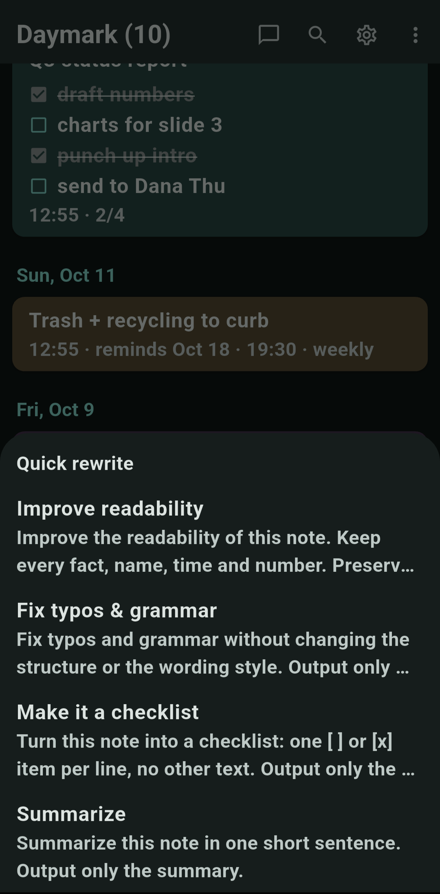
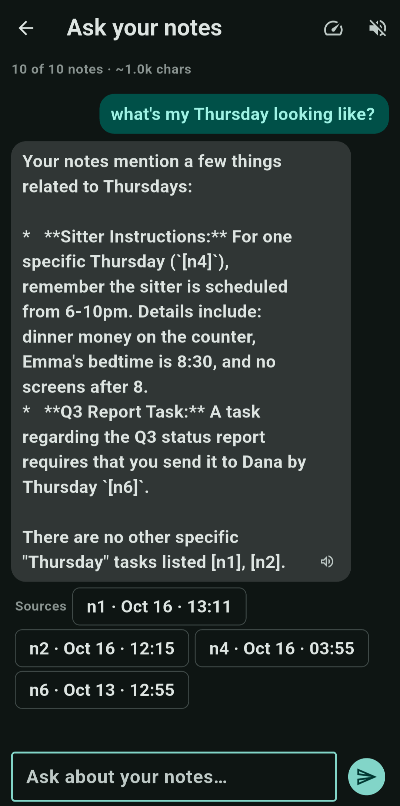
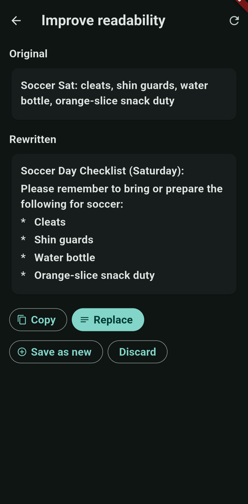
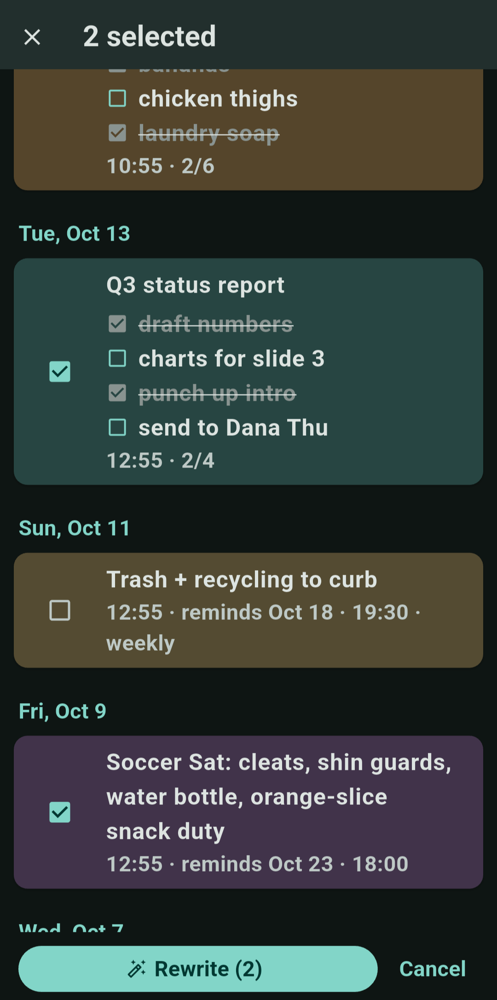

# Daymark

A companion app to [JotLock](https://github.com/Ryfire/jotlock) that turns
your exported note backups into answers — and better notes. It runs entirely
on your device; you bring the LLM.

JotLock is the capture half: fast, offline, lock-screen-first note taking.
Daymark is the processing half: it imports JotLock's JSON backups, keeps a
local mirror of them on a day-grouped timeline, lets you interrogate your
own notes with an LLM you choose and host, and can tidy up the shorthand
you jotted down.

## Screenshots

| **Library & quick rewrite** | **Grounded ask with sources** |
| :--- | :--- |
|  |  |
| **Review a rewrite** | **Batch selection** |
|  |  |

## What it does

- **Grounded ask-over-notes** — ask a question and the app selects the
  relevant notes, puts them in context with their full dates, and streams
  an answer that cites what it used (`[n1]`, `[n2]`…). The prompt is
  anchored in "today" so relative day names (tomorrow, "Thursday") resolve
  the way you mean them. A **Sources** row under each answer maps the
  citations back to the real notes; tap a chip to open the note. If the
  notes don't contain the answer, the model is instructed to say so
  instead of guessing.
- **Duplicate triage** — "Find duplicates" scans the library for exact
  and near-duplicate notes (case, punctuation and checklist-marker
  differences ignored; near-repeats group at 75% token overlap) and lets
  you delete extra copies behind a confirmation. Deletion removes
  Daymark's copy only — JotLock keeps its own, so re-importing a backup
  can restore anything removed here.
- **Batch rewrite sessions** — select any number of notes (⋮ → Select
  notes), apply one prompt, and review each streamed result as it lands:
  keep it (saved as a new note; batch never overwrites originals) or
  skip it. At the end, kept rewrites can be sent to JotLock one share at
  a time — each opens JotLock's editor pre-filled for you to confirm.
- **Quick rewrite** — long-press a note and pick a prompt: improve
  readability, fix typos & grammar, turn it into a checklist, summarize.
  The rewrite streams in next to the original; then copy it, replace the
  note (undoable — the pre-edit text is kept and a revert action stays on
  the note), save it as a new one, or send it to JotLock as a new note
  (JotLock's editor opens pre-filled; you confirm the save there).
  Prompts are fully editable: add your
  own, tweak the wording, restore the defaults — all in Settings.
- **Share-sheet intake** — export a backup from JotLock (Settings → Export
  notes (JSON)) and share it straight to Daymark. Re-shares are merged by
  note id, so only what's new gets imported. A file-picker import is also
  available.
- **Note management** — delete a single note or clear the whole library,
  always behind a confirmation. JotLock keeps its own copies; re-importing
  a backup only adds what's missing, so your edits and removals stick.
- **Day-grouped library** — imported notes appear on a day-grouped
  timeline with search, checklist rendering, priority-color tints, pins
  and reminders shown exactly as JotLock renders them.
- **Bring your own provider** — one generic OpenAI-compatible endpoint:
  base URL, optional API key, model picker fetched from `/v1/models`, and a
  test connection. Works with Ollama, LM Studio, llama.cpp server, or a
  cloud gateway. No built-in presets by design.
- **Reads your notes aloud** — tap the speaker on any reply (system TTS
  engine), or flip on autoplay; a speed slider with live preview is built in.

## Privacy & data

Notes live in a local SQLite database on your device. Nothing is synced and
nothing leaves the device except the text of the notes selected for the
question or rewrite you asked for, sent to the LLM endpoint **you**
configured. There are no accounts, no analytics, and no bundled AI service.
Daymark never modifies or deletes your notes in JotLock. Deleted notes
are gone from Daymark only — JotLock still has them. The only write
direction is explicit: **Send to JotLock** on the rewrite screen shares
the rewritten text back, where it lands as a *new* note next to the
original (you confirm the save in JotLock).

## Building

```sh
flutter pub get
flutter test
flutter build apk --release   # or: flutter run
```

Requires Flutter 3.47+ (Android target).

Release builds are signed with the real release keystore when
`android/key.properties` exists (it points at a keystore outside the repo —
never commit the file or the key), and fall back to the Android debug key
when it doesn't, so a fresh clone always builds.

## Provider setup

Daymark speaks the OpenAI-compatible API dialect — `POST /v1/chat/completions`
and `GET /v1/models` — so it works with any server or service that implements
it. Enter the API root as the Base URL, add an API key if the endpoint needs
one, then **Fetch** to list models, pick one, **Save**, and **Test
connection**.

**Self-hosted (no API key needed)**

- **Ollama**: `http://<host>:11434/v1`
- **LM Studio**: `http://<host>:1237/v1` (or wherever its server runs)
- **llama.cpp server**: `http://<host>:8080/v1`

**Hosted (API key required)**

- **OpenRouter**: `https://openrouter.ai/api/v1`
- **OpenAI**: `https://api.openai.com/v1`
- Anything else exposing the OpenAI shape (vLLM, LiteLLM, Azure gateways...)

LAN endpoints over plain HTTP are supported (Android cleartext is enabled
for this reason). If the server runs on another device on your network,
two one-time steps are needed — the same ones any LAN client requires,
nothing Daymark-specific:

1. **Serve on the network, not just localhost.** Ollama: `OLLAMA_HOST=0.0.0.0`
   (or `ollama serve --host 0.0.0.0`). LM Studio: Developer tab →
   **Serve on Local Network**. llama.cpp: `--host 0.0.0.0`.
2. **Allow the port through the OS firewall** for inbound connections
   (Windows offers the allow dialog on first listen — tick Private
   networks).

If connections time out instead of being refused, the firewall is dropping
inbound traffic to the server's port. A DHCP reservation on the router
keeps the server's IP stable so the Base URL never needs updating.

## Roadmap

- Digests generated on import (no daily ritual required)
- Silent write-back: a no-UI save receiver in JotLock so "Send to
  JotLock" appends without the confirmation tap (requires a JotLock-side
  change; the share-based flow needs none)
- In-app speech-to-text
- v2: on-device inference (llama.cpp) and on-device neural TTS (Piper), for a
  fully offline loop
